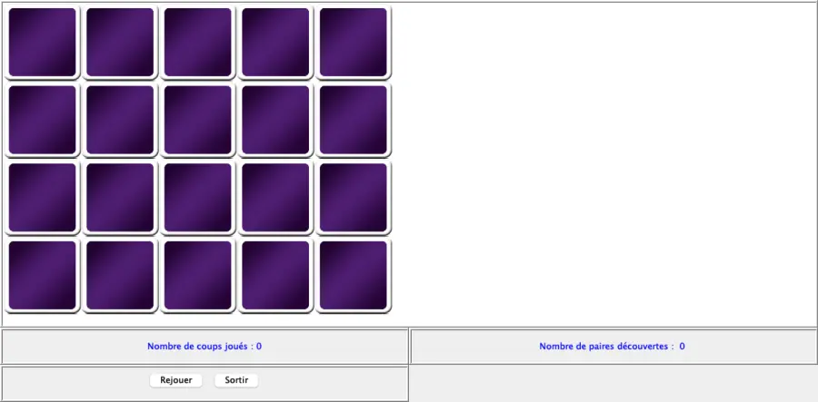

# Memory

[](https://github.com/LaCobble/Memory/actions/workflows/ci.yml)
[](LICENSE)


The classic Memory card game (find the matching pairs), written in Java with Swing and structured around the **MVC** (Model-View-Controller) pattern.



*Start screen, rendered from the real Swing window. The interface text is in French ("Nombre de coups joués" = moves played, "paires découvertes" = pairs found, "Rejouer" = replay, "Sortir" = quit).*

## What it does

- Lays out 10 pairs of images face down on a 4 x 5 grid.
- Click two cards to turn them over: a matching pair stays visible, otherwise both cards are turned back on the next click.
- Live counters for the number of moves and the number of pairs found.
- "Rejouer" shuffles the cards and starts a new game (the very first layout is fixed), "Sortir" quits.

## Requirements

- A JDK (tested with JDK 17).

## Build and run

The images are loaded from the relative path `images/`, so run the game from `src/`:

```bash
git clone https://github.com/LaCobble/Memory.git
cd Memory/src
javac -encoding UTF-8 -d ../out *.java
java -cp ../out Principale
```

## Project structure

```
src/
├── Principale.java       # Entry point: builds the window and wires the MVC parts
├── Model.java            # Game state and rules: card order, visible cards, moves, pairs, shuffle
├── Controler.java        # Mouse clicks on the grid -> model.modifier(cell)
├── ControlerBouton.java  # "Replay" / "Quit" buttons
├── PanneauImages.java    # View: the grid of cards
├── VueNbCoups.java       # View: move counter
├── VueNbPaires.java      # View: pair counter
└── images/               # Card back (fond.png) and the 10 card faces
```

## What it demonstrates

- The **MVC** architecture: the model knows nothing about Swing, the views observe it (`java.util.Observable` / `Observer`), the controllers translate user events into model updates.
- Event-driven GUI programming with Swing (mouse listeners, layouts, borders).
- Simple game-state management (shuffling, pair detection, counters).

## Context

School project from an advanced algorithms lab (2022). The code and identifiers are in French; it is kept as it was written, as a record of the work.

## Contributing

This is an archived learning project, but issues and pull requests are welcome: see [CONTRIBUTING.md](CONTRIBUTING.md) and the [Code of Conduct](CODE_OF_CONDUCT.md).

## License

[MIT](LICENSE) © LaCobble
